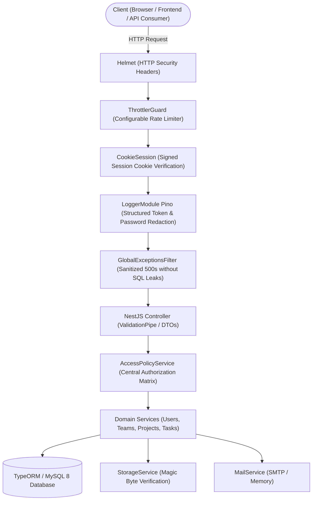
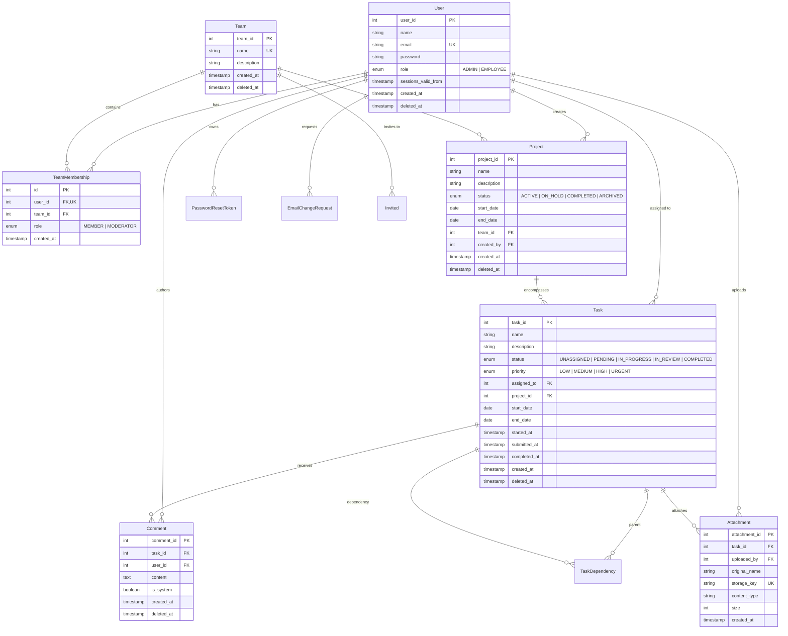
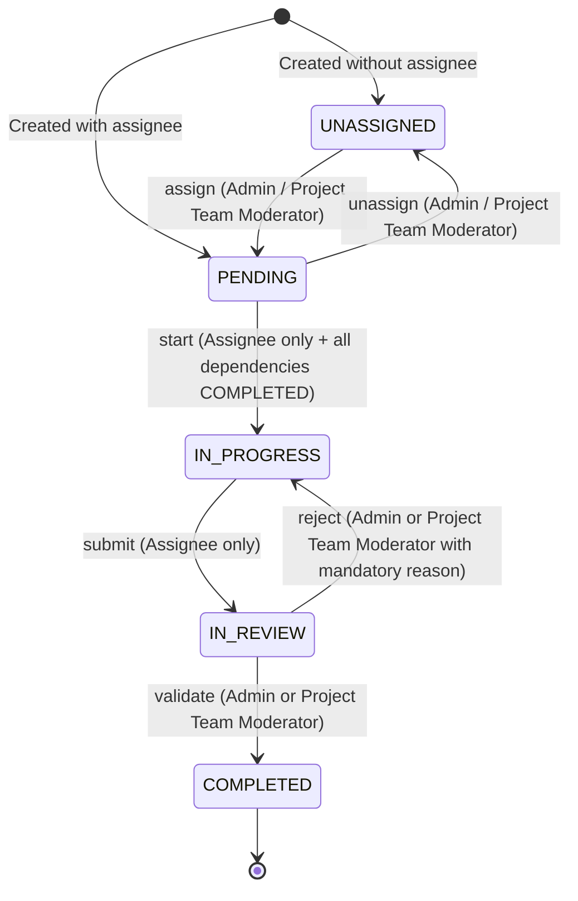

# Intraflow API 🚀

[](https://github.com/medaich/intraflow-api/actions/workflows/ci.yml)
[](https://nodejs.org)
[](https://pnpm.io)

Robust and modular enterprise REST API designed for internal operations management, team coordination, and task tracking governed by strict finite state machines. Built with **NestJS 11**, **TypeORM**, and **MySQL 8**, Intraflow features fine-grained multi-tier RBAC authorization, acyclic task dependency management (DAG), magic-byte MIME attachment validation, cryptographically signed session cookies with instant revocation, and automated email flows for invitations and password resets.

---

## 🛠️ Tech Stack

- **Runtime & Language**: Node.js 22 LTS, TypeScript 5.8.3
- **Web Framework**: NestJS 11 (powered by Express 5)
- **Database & ORM**: MySQL 8.0, TypeORM 0.3 (strict versioned migrations)
- **Security & Sessions**: Cryptographically signed cookie sessions, Helmet, Pino HTTP (structured log redaction), Throttler (configurable reverse proxy rate-limiting)
- **File Storage**: Abstracted local disk storage service with binary magic byte inspection (anti-spoofing)
- **Email Delivery**: Mailer service (SMTP / in-memory transports) with secure HTML templates and anti-XSS escaping
- **Testing & Quality**: Jest, Supertest, ESLint 9, Docker multi-stage builds, GitHub Actions CI

---

## 📐 Architecture & Request Pipeline



---

## 🗄️ Data Model (ERD)



---

## 🔄 Task State Machine (Workflow)



> **Note on Blocked Tasks:** "Blocked" (`isBlocked: true`) is not a stored database enum value, but a derived property computed dynamically whenever one or more direct upstream dependencies have not yet reached the `COMPLETED` state.

---

## 🔐 Permissions Matrix (Actor × Action)

Enforced centrally across `AccessPolicyService` and automated end-to-end authorization suites:

| Resource & Action | ADMIN | TEAM MODERATOR | TEAM MEMBER | OTHER EMPLOYEE |
| :--- | :---: | :---: | :---: | :---: |
| **Create / Delete Team** | ✅ | ❌ | ❌ | ❌ |
| **Manage Team Roster (Add/Remove)** | ✅ | ✅ (MEMBERs in own team) | ❌ | ❌ |
| **View Team Details** | ✅ | ✅ (Own team) | ✅ (Own team) | ❌ |
| **Create Project** | ✅ | ❌ | ❌ | ❌ |
| **View Project Details & Tasks** | ✅ | ✅ (Own team) | ✅ (Own team) | ❌ |
| **Close Project (`COMPLETED`)** | ✅ | ✅ (If all tasks COMPLETED) | ❌ | ❌ |
| **Create Task in Project** | ✅ | ✅ (Own team) | ❌ | ❌ |
| **Assign Task** | ✅ | ✅ (To team members) | ❌ | ❌ |
| **Start Task (`start`)** | ❌ | ✅ (If assigned) | ✅ (If assigned) | ❌ |
| **Submit Task (`submit`)** | ❌ | ✅ (If assigned) | ✅ (If assigned) | ❌ |
| **Validate Task (`validate`)** | ✅ | ✅ (Own team) | ❌ | ❌ |
| **Reject Task (`reject`)** | ✅ | ✅ (Own team) | ❌ | ❌ |
| **Manage Task Dependencies** | ✅ | ✅ (Own team) | ❌ | ❌ |
| **Upload Task Attachment** | ✅ | ✅ (Own team) | ✅ (If assigned) | ❌ |
| **Delete Comment** | ✅ (All) | ✅ (On team's tasks) | ✅ (Own comments) | ❌ |

---

## 🚀 Quick Start with Docker

A clean clone requires only the sample environment file to run immediately:

```bash
# 1. Clone and configure environment
cp .env.example .env

# 2. Start full infrastructure stack
docker compose up --build -d
```

Automatically launched services:
- **MySQL 8**: `localhost:3308` (database: `intraflow`)
- **Mailpit**: `localhost:8025` (web UI) / `localhost:1025` (SMTP server)
- **Migration**: Applies compiled TypeORM migrations automatically on startup
- **Intraflow API**: `http://localhost:3000` (ready once migrations complete)
  - Interactive Swagger Docs: `http://localhost:3000/docs`
  - Health check endpoint: `http://localhost:3000/health`

To stop and purge all container volumes:
```bash
docker compose down -v
```

---

## 💻 Local Development

### Prerequisites
- Node.js >= 22.0.0
- pnpm >= 9.0.0
- Docker Desktop or local MySQL instance

### Installation & Startup
```bash
# Install dependencies with locked versions
pnpm install

# Start support services (MySQL 8 + Mailpit)
docker compose up -d mysql mailpit

# Run TypeORM migrations on dev database
pnpm run migration:run

# Launch NestJS development server with hot-reload
pnpm run start:dev
```

Initial bootstrapped administrator credentials (development/local):
- **Email**: `admin@intraflow.dev`
- **Password**: `AdminPassword123!`

---

## ⚙️ Environment Variables

| Variable | Required | Default Value | Description |
| :--- | :---: | :---: | :--- |
| `NODE_ENV` | No | `development` | Environment mode (`development`, `production`, `test`, `provision`) |
| `PORT` | No | `3000` | HTTP port the application listens on |
| `APP_URL` | No | `http://localhost:3000` | Public base URL used in generated email links |
| `TRUST_PROXY` | No | `0` | Number of trusted upstream reverse proxies (0 = disabled; integer >= 0) |
| `COOKIE_SECURE` | No | `true` in prod, `false` otherwise | Secure flag for session cookies (rejected in prod if false unless host is localhost) |
| `CORS_ORIGIN` | No | `http://localhost:5173` | Allowed Origin for CORS requests |
| `COOKIE_KEY` | **Yes** | - | Secret signing key for session cookies (min. 16 chars; min. 32 chars in production) |
| `TOKEN_EXPIRATION` | No | `86400` | Lifetime of signup invitation tokens (seconds) |
| `EMAIL_CHANGE_TOKEN_TTL` | No | `3600` | Lifetime of email change verification tokens (seconds) |
| `RESET_TOKEN_TTL` | No | `3600` | Lifetime of password reset tokens (seconds) |
| `MYSQL_HOST` | **Yes** | `localhost` | MySQL database host |
| `MYSQL_PORT` | **Yes** | `3306` (or `3308`) | MySQL database port |
| `MYSQL_DATABASE` | **Yes** | `intraflow` | MySQL database name |
| `MYSQL_USERNAME` | **Yes** | `root` | MySQL user |
| `MYSQL_ROOT_PASSWORD` | **Yes** | - | MySQL root user password |
| `ADMIN_EMAIL` | No | `admin@intraflow.dev` | Initial admin email (required in prod on first boot if users table is empty) |
| `ADMIN_PASSWORD` | No | - | Initial admin password (required in prod on first boot if users table is empty) |
| `ADMIN_NAME` | No | `Super Admin` | Full display name for initial admin |
| `MAIL_TRANSPORT` | No | `memory` | Email transport engine (`smtp` or `memory`) |
| `SMTP_HOST` | Required if smtp | `localhost` | SMTP mail server hostname |
| `SMTP_PORT` | No | `1025` | SMTP port |
| `MAIL_FROM` | No | `noreply@intraflow.dev` | Sender email address for outgoing messages |
| `STORAGE_DIR` | No | `./storage` | Filesystem directory for task attachment storage |
| `MAX_FILE_SIZE` | No | `10485760` | Maximum upload size per file in bytes (default 10 MB) |
| `MAX_ATTACHMENTS_PER_TASK` | No | `20` | Maximum number of attachments permitted per task |

---

## 📜 Utility Scripts & CLI Commands

| Command | Description |
| :--- | :--- |
| `pnpm build` | Compiles TypeScript source to `dist/` |
| `pnpm run lint` | Lints and auto-fixes source files via ESLint |
| `pnpm test` | Runs Jest unit tests |
| `pnpm run test:cov` | Executes unit tests with coverage metrics |
| `pnpm test:e2e` | Runs comprehensive E2E integration test suite on real `intraflow_test` database |
| `pnpm run check:traceability` | Validates that every entry in `docs/TEST_TRACEABILITY.md` maps literally to test code |
| `pnpm run migration:run` | Executes pending TypeORM database migrations |
| `pnpm run migration:revert` | Reverts the most recently executed migration |
| `pnpm run openapi:export` | Generates static `docs/openapi.json` contract without running a live server |
| `pnpm run seed:demo` | Seeds realistic, idempotent demo data (refuses in production) |
| `pnpm run smoke` | Runs comprehensive zero-dependency end-to-end smoke test script |

---

## 📊 Demo Seed Data (`pnpm seed:demo`)

To facilitate frontend evaluation and reviews, running `pnpm run seed:demo` provisions demo teams, projects, task dependencies, rejection flow history, and tasks illustrating every state (`UNASSIGNED`, `PENDING`, `IN_PROGRESS`, `IN_REVIEW`, `COMPLETED`, with derived `isBlocked: true`).

All demo accounts share the password: `DemoPassword123!`
- **Alpha Moderator**: `mod.alpha@intraflow.dev` (Team *Alpha Core*)
- **Alpha Member**: `dev.alpha@intraflow.dev` (Team *Alpha Core*)
- **Beta Moderator**: `mod.beta@intraflow.dev` (Team *Beta Platform*)
- **Beta Member**: `dev.beta@intraflow.dev` (Team *Beta Platform*)

---

## 🏛️ Architectural & Design Decisions

1. **Signed Session Cookies with Instant Revocation (`sessionsValidFrom`)**:
   Client sessions are managed via cryptographically signed HTTP-only cookies (`cookie-session`). When a user updates their password, confirms an email change, or is deactivated by an administrator, their `sessionsValidFrom` timestamp is updated in the database. During each incoming request, `AuthGuard` queries the database once and immediately rejects any session issued prior to that timestamp.
2. **Centralized Access Policy (`AccessPolicyService`)**:
   Authorization logic (project scoping, task lifecycle transitions, comment moderation) is decoupled from controllers and centralized into `AccessPolicyService`, supplemented by route guards and state assertions.
3. **Deterministic State Machine & Pessimistic Concurrency Locking**:
   State transitions are executed inside database transactions using pessimistic write locks (`pessimistic_write`) to serialize concurrent actions. Rejections (`IN_REVIEW` → `IN_PROGRESS`) mandate an explicit review note and record a traceable user comment under the reviewer's identity.
4. **DAG Cycle Prevention with Database Serialization**:
   Task dependencies within a project are validated using depth-first search (DFS) under an explicit pessimistic write lock on the project entity, guaranteeing an acyclic directed graph (DAG) free from concurrent race conditions.
5. **Standardized Pagination & SQL Injection Defense**:
   Primary resource endpoints (`/users`, `/teams`, `/projects`, `/tasks`) return a standard `{ data, meta }` envelope. All search filters escape SQL wildcard metacharacters (`%` and `_`).

---

## 🛡️ Security Hardening

- **Password Hygiene**: Password hashes use scrypt with 16-byte cryptographically secure salts (`v2.<salt>.<hash>`). Database projections exclude passwords by default (`select: false`), and response DTOs strictly strip extraneous fields.
- **Anti-Enumeration Protection**: Signin and password reset endpoints return uniform HTTP responses with equivalent computational work (applying `dummyHash` for non-existent users).
- **Attachment Protection**: Content sniffing inspects the first 1024 bytes of file uploads, strictly rejecting SVGs, HTML, scripts, and executable binaries (`415 Unsupported Media Type`), combined with the `X-Content-Type-Options: nosniff` header.
- **Structured Log Redaction**: Pino HTTP automatically censors sensitive headers (`cookie`, `set-cookie`, `authorization`), passwords, and token fields. Unhandled errors are logged with structured context and redacted URLs.
- **Shielded Error Responses**: Production 500 responses return generic JSON errors without stack traces or raw SQL details.

---

## 📋 Known Limitations

- **In-Memory Rate Limiting (Single Instance)**: `ThrottlerGuard` uses in-memory tracking local to the process. Deployments behind multi-instance load balancers should integrate a shared store (such as Redis).
- **Local Disk Storage**: File attachments are currently stored on the local filesystem (`LocalDiskStorage`).
- **Non-Atomic Disk File Deletion**: Attachment deletion deletes the database record first before unlinking the file on disk. Filesystem errors are logged but do not roll back the database transaction.
- **Unqueued Background Emails**: Password reset emails are dispatched asynchronously in background promises without blocking the HTTP response, but without a persistent message broker (e.g., BullMQ) for offline retry handling.
- **File Inspection Window**: Magic byte MIME detection and malicious tag detection (SVG/HTML scripts) are performed on the initial 1024 bytes of uploaded files.
- **Dependency Audit Non-Blocking**: Automated dependency vulnerability scanning is not configured as a blocking gate in CI.

